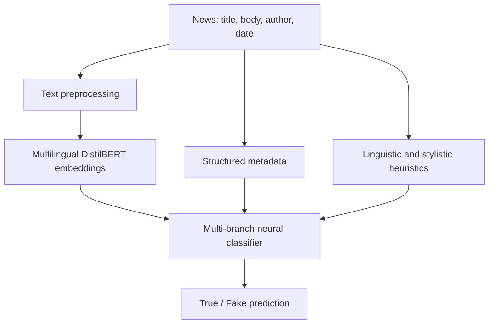
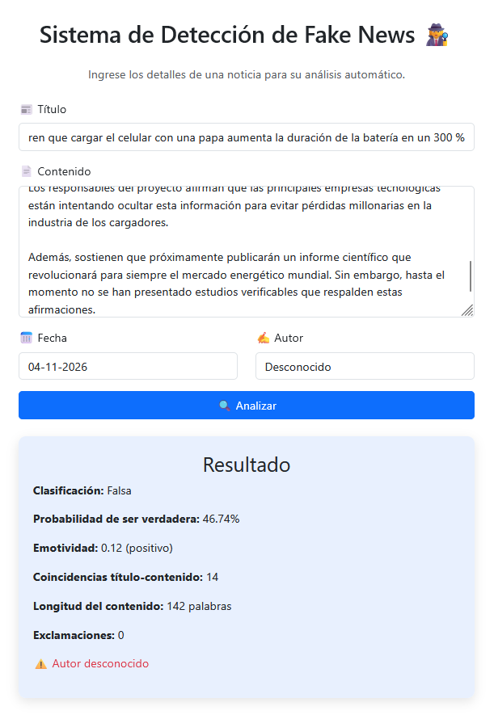

# CAHD — Context-Aware Hybrid Detection

**Hybrid fake news detection for Spanish-language news using multilingual DistilBERT, metadata, and linguistic heuristics.**

[Versión en español](README_ES.md)

> Academic research prototype. A model prediction is **not** independent fact-checking or proof that a claim is true or false.

## Overview

CAHD is a hybrid approach to binary fake-news classification. It combines contextual text representations from **multilingual DistilBERT**, structured **news metadata**, and interpretable **linguistic/stylistic features**. The three feature streams are processed by a multi-branch neural network implemented in TensorFlow/Keras and fused to produce a classification score.

The project also includes a Flask interface where a user can enter a title, content, author, and publication date and inspect a prediction with selected descriptive signals.

## Architecture



**Feature branches**

- **Semantic:** the contextual embedding of the news body from `distilbert-base-multilingual-cased` (first-token representation).
- **Metadata:** title/body lengths and ratios, punctuation, sensationalist expressions, author features, and calendar-derived variables.
- **Heuristics:** emotional-word ratio, lexical diversity, modal/subjective expressions, uppercase and short-sentence patterns, and title–body Jaccard similarity.

The current Python implementation contains dense layers, ReLU activations, dropout, and a sigmoid binary output. The application interprets the output as the estimated score for the **true** class (`1`) and uses `0.5` as its decision threshold.

## Data

The academic project constructed a Spanish-language news corpus using news and fact-checking sources discussed in the thesis, including Fast Check CL, Chequeado, Newtral, La República (Verificador), and CIPER Chile. The dataset used here has these fields: `titulo`, `autor`, `fecha`, `contenido`, `label`, `formato_fecha`.

| Dataset snapshot | Count |
| --- | ---: |
| Total records | 6,799 |
| Fake (`label = 0`) | 3,515 |
| True (`label = 1`) | 3,284 |
| Distinct authors | 636 |

This count reflects the CSV inspected for repository preparation. The earlier academic progress report describes a 6,800-record snapshot. The full dataset is intentionally **not redistributed here** pending source-license and data-provenance checks.

## Original experimental results

| Metric | Reported value |
| --- | ---: |
| Accuracy | 0.86 |
| F1-score | 0.86 |
| ROC-AUC | 0.944 |

These are the results reported by the project author for the **original experiment**, not independently reproduced or re-evaluated results. See [Limitations](#limitations-and-responsible-use) for important caveats about the original evaluation protocol.

## Web application

The Flask prototype accepts a news item and displays the predicted class, score, emotional-word ratio, title–body word overlap, text length, and punctuation counts.



*Illustrative inference using a fictional article created for the demonstration. The output was “Falsa” with a 46.74% score for the true class. A single example is not an accuracy test.*

## Running locally

The original application was run successfully on Windows using **Python 3.12** and a local virtual environment. The repository must contain the original model artifacts and preprocessing dependencies in the locations expected by `app.py`; these large or binary files are not bundled with this README.

```powershell
py -3.12 -m venv .venv-tesis
.\.venv-tesis\Scripts\python.exe -m pip install flask pandas numpy scikit-learn joblib torch tensorflow==2.19.0 transformers==4.51.3 spacy nltk
.\.venv-tesis\Scripts\python.exe -m spacy download es_core_news_sm
.\.venv-tesis\Scripts\python.exe -c "import nltk; nltk.download('stopwords')"
.\.venv-tesis\Scripts\python.exe app.py
```

Open <http://127.0.0.1:5000> when Flask starts. This is a **local development workflow**, not a production deployment guide. A locked dependency file and portable artifact-download instructions are still to be finalized.

## Limitations and responsible use

- **Evaluation leakage:** some scalers and the author encoder were fitted before the train/validation/test split in the original notebook. This can influence evaluation estimates; the reported metrics must not be presented as leakage-free performance.
- **Date processing:** the reviewed CSV contains ISO-format dates while part of the original feature pipeline expects day-month-year strings. Date-derived inputs need validation in a future retraining cycle.
- **Author frequency:** the application computes author-frequency features from the received batch, which may differ from training-time behavior. The original implementation is preserved for this archival presentation.
- **Source/style bias:** fake and true articles were assembled from different publication types and sources, which can create shortcuts unrelated to factual truth.
- **Distribution shift:** new events, unseen sources, short posts, and synthetic examples may behave differently from the curated academic dataset.
- **Interpretability:** displayed heuristics are descriptive features, not proof that any one feature caused the prediction.

The recommended next experimental step is to re-fit preprocessing **only on training data**, assess possible overlap between train/test articles, harmonize date/author features, and evaluate on independent sources. No such retraining is claimed here.

## Technologies

Python · TensorFlow/Keras · PyTorch · Hugging Face Transformers · DistilBERT · scikit-learn · pandas · NumPy · spaCy · NLTK · Flask

## Academic context and credits

The source academic report is titled *“Técnicas de detección de Fake News actuales, con la implementación de un prototipo en base a ellas”* (Trabajo de Título 2, Universidad Tecnológica Metropolitana, 2025).

**Project team:** Sebastián Castro Cisternas, **Fabián Rojas Gamboa**, and Sebastián Villalobos Pereira. **Instructor:** Jorge Morris Arredondo.

**Contributions (as reported by Fabián):** data collection and cleaning, exploratory data analysis, research, and academic writing were **collaborative efforts of the project team**. Fabián also contributed to development of the hybrid model, its training, and its evaluation. **The Flask application was developed by another member of the team**, so its implementation is not attributed to Fabián.

Dataset redistribution rights and publication permission for the complete academic report should be confirmed before public release. This repository description does not claim that the whole group project was completed by one person.
