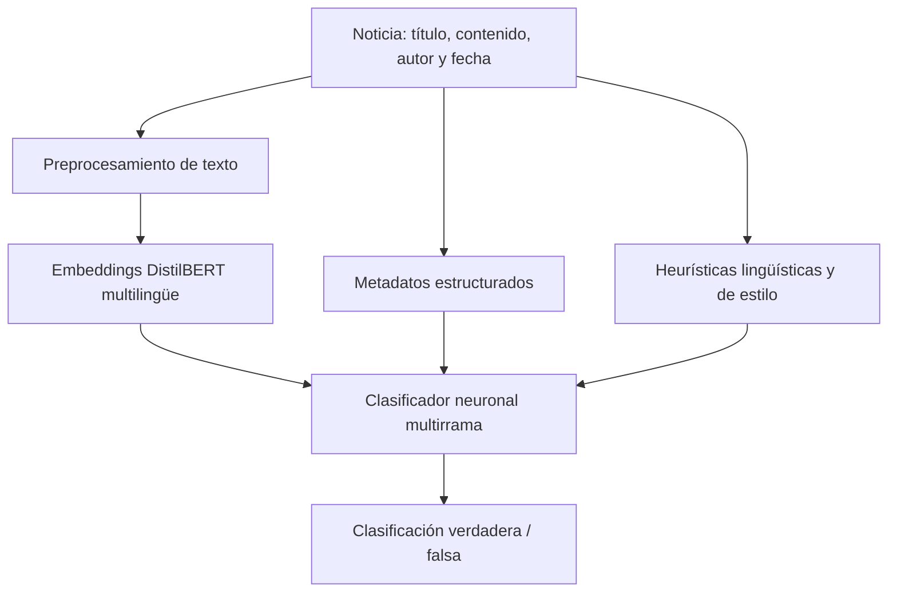
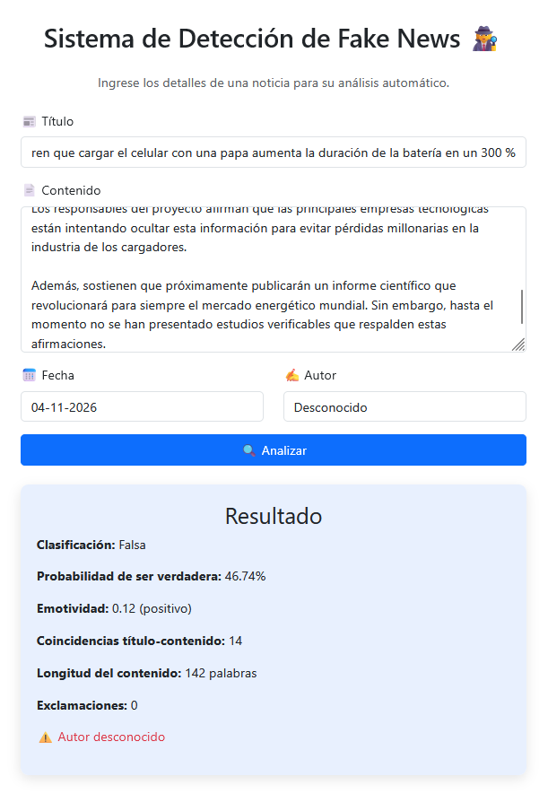

# CAHD — Context-Aware Hybrid Detection

**Sistema híbrido de detección de noticias falsas en español mediante DistilBERT multilingüe, metadatos y heurísticas lingüísticas.**

[English version](README.md)

> Prototipo académico de investigación. Una predicción del modelo **no equivale a una verificación de hechos** ni demuestra por sí misma la veracidad de una noticia.

## Descripción

CAHD combina tres fuentes de características para clasificar noticias: representaciones semánticas de **DistilBERT multilingüe**, **metadatos** estructurados y señales **lingüísticas/estilísticas**. Estas representaciones se procesan en una red neuronal multirrama implementada con TensorFlow/Keras, cuya salida permite clasificar el texto como verdadero o falso según un umbral.

El proyecto incluye una aplicación Flask que recibe título, contenido, autor y fecha, y muestra una predicción junto con características descriptivas de la noticia.

## Arquitectura



- **Rama semántica:** embedding contextual del cuerpo de la noticia mediante `distilbert-base-multilingual-cased`.
- **Rama de metadatos:** longitud y relación título-cuerpo, puntuación, términos sensacionalistas, autoría y variables temporales.
- **Rama heurística:** emotividad, diversidad léxica, términos de incertidumbre y opinión, patrones sintácticos y similitud Jaccard entre título y cuerpo.

La implementación utiliza capas densas, ReLU, dropout y salida sigmoide. En el código de la aplicación, el puntaje se interpreta como la estimación de la clase **verdadera** (`1`), con umbral de `0.5`.

## Datos

El proyecto académico construyó un corpus de noticias en español a partir de fuentes periodísticas y de verificación descritas en el informe, entre ellas Fast Check CL, Chequeado, Newtral, La República (Verificador) y CIPER Chile.

| Versión del CSV revisado | Registros |
| --- | ---: |
| Total | 6.799 |
| Noticias falsas (`0`) | 3.515 |
| Noticias verdaderas (`1`) | 3.284 |
| Autores distintos | 636 |

El informe académico anterior describe una versión con 6.800 registros. No se distribuye aquí el dataset completo hasta verificar derechos de uso, procedencia y condiciones de redistribución.

## Resultados del experimento original

| Métrica | Valor informado |
| --- | ---: |
| Accuracy | 0,86 |
| F1-score | 0,86 |
| AUC-ROC | 0,944 |

Son métricas informadas por el autor para el experimento original. **No se han reproducido mediante una nueva evaluación corregida.** Consulta las limitaciones metodológicas más abajo.

## Aplicación web

La interfaz Flask permite ingresar una noticia y visualizar clasificación, puntaje, emotividad, coincidencias título-contenido, longitud y signos de exclamación.



*Ejemplo de demostración con una noticia ficticia: clasificación «Falsa» y un 46,74 % como puntaje de la clase verdadera. No constituye una prueba estadística de rendimiento.*

## Ejecución local en Windows

Se comprobó la ejecución de la aplicación original en **Python 3.12**. Para repetirla se necesitan los artefactos originales de modelo y los transformadores guardados en las rutas esperadas por `app.py`.

```powershell
py -3.12 -m venv .venv-tesis
.\.venv-tesis\Scripts\python.exe -m pip install flask pandas numpy scikit-learn joblib torch tensorflow==2.19.0 transformers==4.51.3 spacy nltk
.\.venv-tesis\Scripts\python.exe -m spacy download es_core_news_sm
.\.venv-tesis\Scripts\python.exe -c "import nltk; nltk.download('stopwords')"
.\.venv-tesis\Scripts\python.exe app.py
```

Abrir <http://127.0.0.1:5000>. Estas instrucciones son para **desarrollo local**, no para producción. Aún falta cerrar un listado reproducible de versiones y la distribución de artefactos.

## Limitaciones y uso responsable

- **Posible fuga de información:** el notebook original ajusta escaladores y codificación de autores antes de separar entrenamiento, validación y prueba. Las métricas originales no deben describirse como libres de fuga.
- **Fechas:** el CSV revisado almacena fechas ISO, mientras una etapa de preprocesamiento espera día-mes-año.
- **Frecuencias por autor:** en inferencia se calculan sobre el lote recibido y pueden diferir del entrenamiento; se conserva el comportamiento original en esta etapa.
- **Sesgo por fuente:** las clases provienen parcialmente de distintos tipos de medios, de modo que el modelo puede aprender señales de publicación en vez de veracidad.
- **Generalización:** publicaciones nuevas, dominios distintos y textos muy cortos requieren una evaluación independiente.
- **Explicabilidad:** las heurísticas presentadas son atributos descriptivos; no prueban causalidad en la decisión.

Una futura evaluación debería ajustar transformadores solo con entrenamiento, revisar duplicados entre particiones, corregir metadatos y probar fuentes independientes. **No afirmamos haber realizado ese reentrenamiento.**

## Tecnologías

Python · TensorFlow/Keras · PyTorch · Hugging Face Transformers · DistilBERT · scikit-learn · pandas · NumPy · spaCy · NLTK · Flask

## Contexto académico y créditos

Informe fuente: *“Técnicas de detección de Fake News actuales, con la implementación de un prototipo en base a ellas”* (Trabajo de Título 2, Universidad Tecnológica Metropolitana, 2025).

**Integrantes:** Sebastián Castro Cisternas, **Fabián Rojas Gamboa** y Sebastián Villalobos Pereira. **Profesor:** Jorge Morris Arredondo.

**Contribuciones (según lo informado por Fabián):** la recolección y limpieza de datos, el análisis exploratorio, la investigación y la redacción académica fueron **trabajos colaborativos del equipo**. Fabián también participó en el desarrollo del modelo híbrido, su entrenamiento y su evaluación. **La aplicación Flask fue desarrollada por otro integrante**, por lo que no se atribuye su implementación a Fabián.

Antes de publicar conviene confirmar el permiso para compartir el informe completo y los derechos de redistribución del dataset. No se atribuye el proyecto grupal exclusivamente a una persona.
